# DayZ Server Manager

[](https://go.dev)
[](LICENSE.md)
[](#)

**Author:** Aristarh Ucolov — © 2026. All rights reserved.

**[English](#english) · [Русский](#русский) · [Changelog](CHANGELOG.md)**

---

# Русский

[English version ↓](#english)

**DayZ Server Manager** — один исполняемый файл, который кидается в папку
DayZ Server и превращает обычный сервер в удобную панель управления. Никаких
`Notepad`, никаких `.bat` — всё через приятный интерфейс. Вдохновлён панелями
хостингов GTA SA:MP.

Есть две сборки с общими настройками — выбирайте любую:

| файл | как выглядит |
|------|--------------|
| `dayz-manager-panel.exe` / `dayz-manager-panel-linux` | **Приложение** — панель в собственном окне, значок в трее; при закрытии окна сервер DayZ можно оставить работать |
| `dayz-manager-web.exe` / `dayz-manager-web-linux` | **Браузерная** — консоль + панель во вкладке браузера (бывший `dayz-manager.exe`); подходит и для VPS без рабочего стола |

<p align="center">
  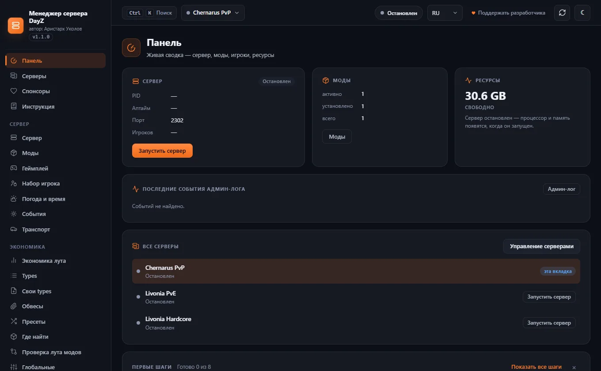
</p>

<table>
  <tr>
    <td width="50%">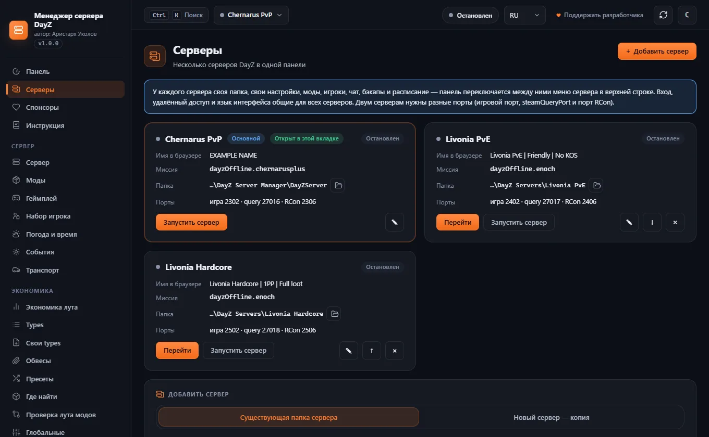<br>
      <b>Серверы</b> — несколько серверов DayZ в одной панели: своя папка, настройки и порты у каждого</td>
    <td width="50%">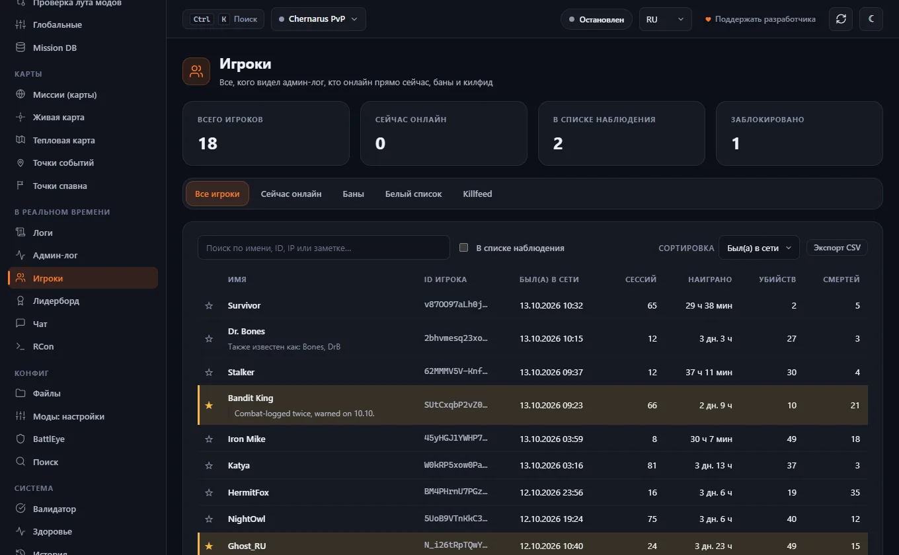<br>
      <b>Игроки</b> — все игроки, кто сейчас онлайн, баны с причиной и сроком, килфид</td>
  </tr>
  <tr>
    <td width="50%">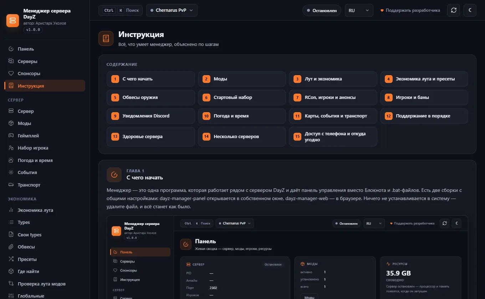<br>
      <b>Инструкция</b> — пятнадцать глав с пошаговыми объяснениями, скриншотом раздела и переходом прямо в нужную страницу</td>
    <td width="50%">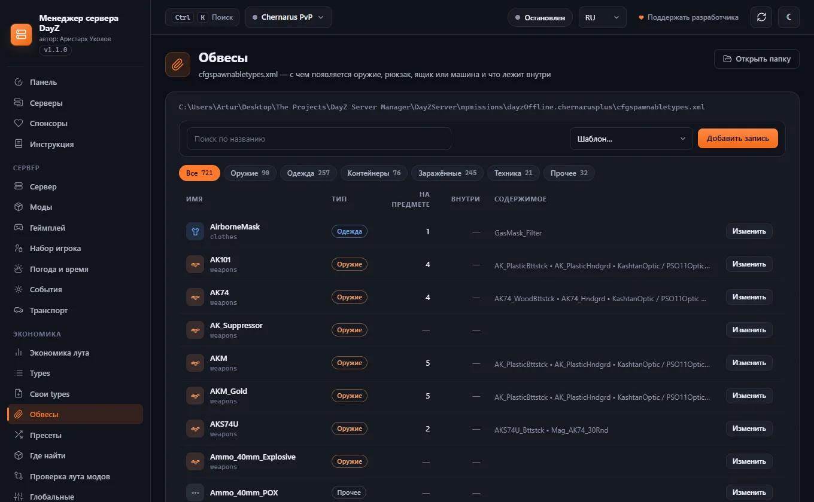<br>
      <b>Обвесы</b> — cfgspawnabletypes.xml с реальными процентами спавна вместо сырых весов</td>
  </tr>
  <tr>
    <td>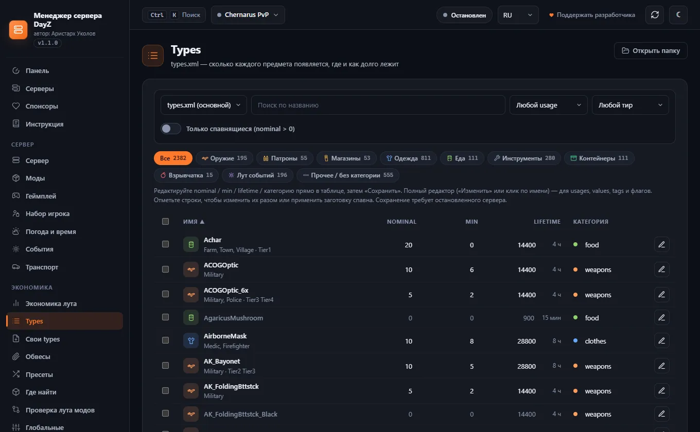<br>
      <b>Лут</b> — types.xml с поиском, правкой прямо в таблице и массовыми заготовками</td>
    <td>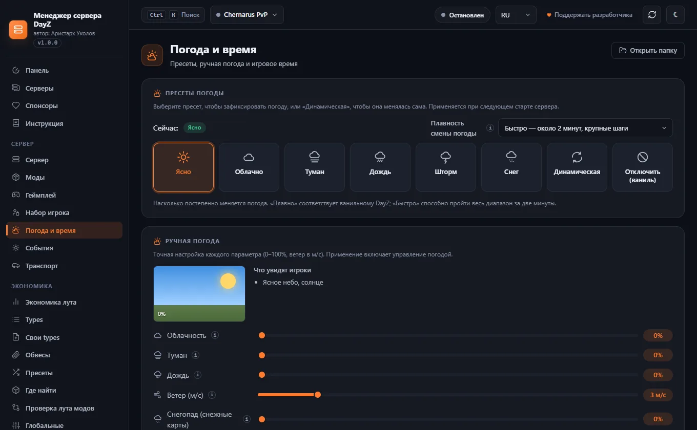<br>
      <b>Погода</b> — пресеты, ручная настройка и плавность перехода</td>
  </tr>
  <tr>
    <td>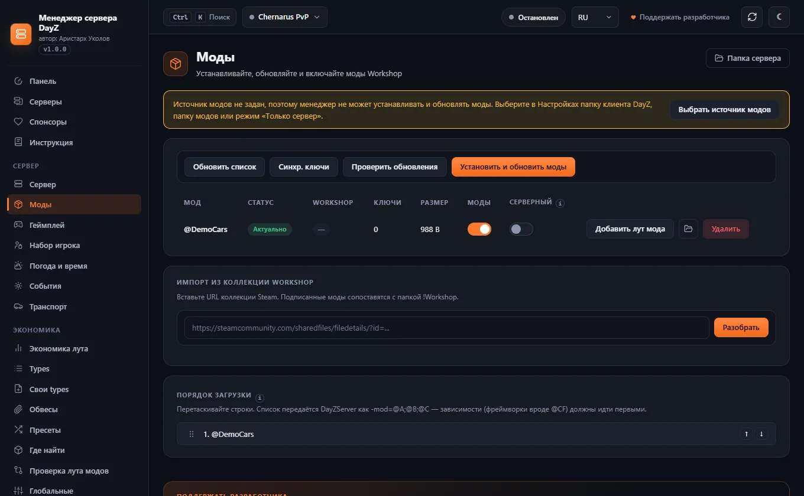<br>
      <b>Моды</b> — установка из !Workshop, ключи, порядок загрузки, авто-обновление</td>
    <td>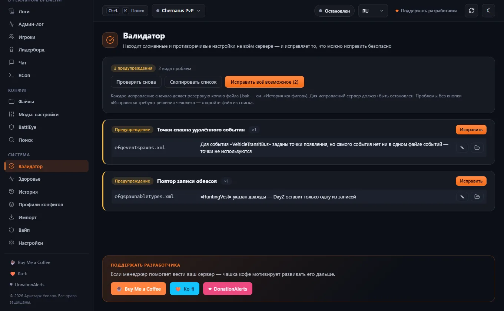<br>
      <b>Валидатор</b> — проверка XML, ссылок между файлами и значений с авто-исправлением</td>
  </tr>
  <tr>
    <td>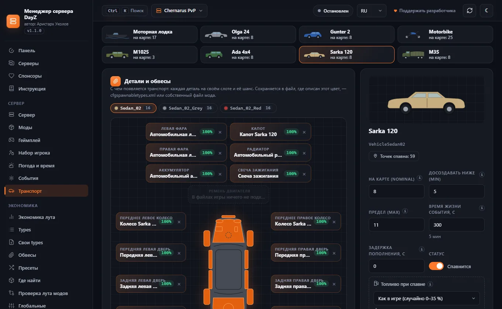<br>
      <b>Транспорт</b> — машина нарисована с деталями на своих местах, цвета, багажник, топливо при спавне</td>
    <td>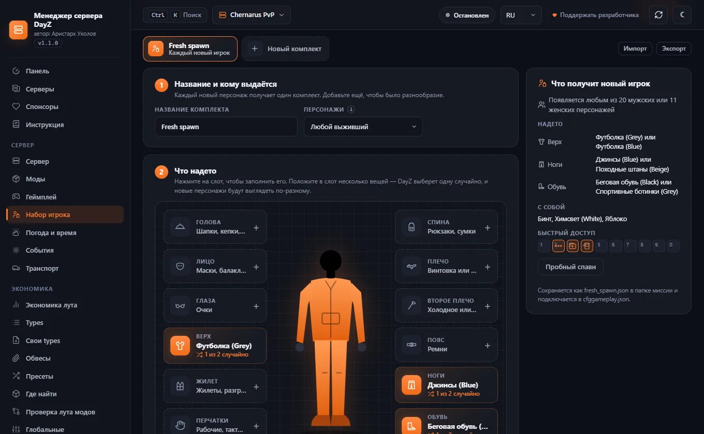<br>
      <b>Набор игрока</b> — персонаж со слотами, обвесы, клавиши быстрого доступа, сытость и тепло при появлении</td>
  </tr>
</table>

## Последнее обновление — 1.1 «Хэллуинское»

Раздел **Транспорт** теперь устроен как «Набор игрока»: машина нарисована
сверху, у каждой детали своя плитка, у каждого цвета — свои детали и багажник.
**Обвесы** и **Пресеты** получили тот же вид — рисунок предмета и строки с
иконками вместо голых классов. В «Наборе игрока» — клавиши для вложенных
вещей, заряженное оружие (патрон уже в патроннике), сытость, вода и тепло
нового персонажа, а также правила DayZ для обвесов (штык-нож и глушитель,
фонарь и цевьё с планкой). Менеджер сам поднимается после сбоя, а моды из
Steam Workshop скачиваются напрямую через SteamCMD.

Полный список изменений по версиям — в [CHANGELOG.md](CHANGELOG.md#русский).

## Что умеет

- **Заменяет стандартный .bat.** Запускает `DayZServer_x64.exe` с теми же
  параметрами (port, cpuCount, BEpath, profiles, -mod, -serverMod,
  dologs/adminlog/netlog/freezecheck, опционально filePatching) + опциональный
  авто-рестарт по интервалу.
- **Установка и обновление модов из Steam !Workshop.** Один раз указываешь
  путь к своему клиентскому DayZ — дальше в UI видишь все `@Моды`, которые
  Steam закачал. Жмёшь **Install** — мод копируется в папку сервера, а все
  `.bikey` автоматически переносятся в `keys/`. Жмёшь **Update** —
  перезаливается из Workshop (атомарно: новая версия ставится во временную
  папку и только потом подменяет старую, так что поломанное обновление не
  убивает сервер). Есть **Update all outdated** и **Sync all** — привести
  папку сервера в соответствие с `!Workshop` одним кликом.
- **Авто-обновление модов.** Можно обновлять моды перед каждым рестартом и
  периодически проверять `!Workshop` — если подписанный мод там новее,
  сервер обновится и перезапустится с обычным обратным отсчётом.
- **Watchdog.** Если сервер упал сам — менеджер поднимет его через
  10 секунд. Защита от crash-loop (3 падения за 5 минут) приостанавливает
  авто-рестарты и показывает баннер с кнопкой «Возобновить».
- **Уведомления Discord.** События сервера (запуск, краш, рестарты,
  обновления модов, бэкапы) отправляются в канал Discord через вебхук —
  на языке панели.
- **Порядок загрузки и серверные моды.** Порядок `-mod=` меняется
  перетаскиванием (зависимости вроде `@CF` — первыми). Отдельный тумблер для
  серверных модов (`-serverMod=`).
- **Безопасное удаление модов.** При удалении мода ключи из `keys/`
  удаляются только если **ни один другой установленный мод** не использует
  тот же `.bikey`. Shared-ключи типа `dayzexpansion.bikey` (CF/Core/AI
  делят его) остаются на месте, пока хоть один компонент стоит.
- **Редактор server.cfg в браузере.** Сохраняет комментарии и `class`-блоки
  round-trip (твой форматинг не ломается). Одним полем меняется карта
  (`template=`) — например `dayzOffline.chernarusplus` → `dayzOffline.enoch`.
- **Редактор types.xml.** Таблица с поиском, инлайн-правка `nominal`, `min`,
  `lifetime`, `category` прямо в таблице + полный редактор каждого объекта:
  `restock`, `quantmin/max`, `cost`, `flags`, `usages`, `values`, `tags`.
- **Заготовки спавнов (spawn presets).** Встроенный набор: Military Tier 3/4,
  Civilian, Industrial, Hunting, Rare. Выделяешь объекты → жмёшь заготовку →
  её `usage/value/tag` и настройки спавна применяются ко всем выбранным.
- **Редактор событий (events).** Таблицы спавна зомби, машин, хеликрашей:
  `nominal/min/max/lifetime/restock`, дочерние элементы.
- **Свои types (moded_types).** Создаёшь новый файл своих types; манагер
  **автоматически** вписывает его в `cfgeconomycore.xml`. Можно
  импортировать `*_types.xml` прямо из установленного мода.
- **Редактор обвесов (cfgspawnabletypes.xml).** Задаёшь, с чем спавнится
  оружие: магазин, прицел, приклад, цевьё — слотами с вероятностями.
  Панель показывает **реальный шанс** каждого предмета (шанс слота × вес ÷
  сумма весов) — в сыром XML это легко прочитать неверно. Есть шаблоны
  популярного оружия (AKM, AK-74, AKS-74U, M4-A1, Mosin, SVD), автодополнение
  классов из твоего `types.xml` (включая моды) и подсветка классов, которых
  в `types.xml` нет — обычная причина, почему обвес «не спавнится».
- **Валидатор с авто-исправлением.** Сканирует все `.xml` под `mpmissions/`,
  балансирует скобки в `.cfg`, проверяет существование файлов из
  `cfgeconomycore.xml`, ловит дубликаты types и отмечает спавн-позиции событий,
  вылетающие за карту. **Авто-исправление** вносит неизвестные
  `usage/value/tag/category` в `cfglimitsdefinition.xml`, регистрирует
  незарегистрированные файлы moded_types в `cfgeconomycore.xml`, убирает
  дубликаты `<type>` — и внутри файла, и копии базовых имён из `types.xml`
  (оставляя первый, комментарии сохраняются) — и удаляет осиротевшие
  спавн-позиции для событий, которых больше нет в `events.xml`. Всё с бэкапом.
- **RCon.** Список игроков, kick/ban, broadcast в чат, произвольная команда.
  Пароль RCon задаётся прямо в панели — манагер пишет его в
  `battleye/beserver_x64.cfg` (создаёт файл при необходимости).
- **Анонсы и рестарты.** Анонсы по расписанию (в заданное время суток) и по
  интервалу (каждые N минут), ежедневные рестарты по HH:MM с обратным
  отсчётом-предупреждением по RCon.
- **Погода и время.** Пресеты, ручная настройка каждого канала, ускорение
  дня/ночи и стартовое время (`serverTime`).
- **Вайп сервера.** Очистка сохранённого состояния мира (игроки, машины,
  базы, территории) — папки персистенса сначала перемещаются в
  `.dayz-manager/wipes/<метка>/`, ошибочный вайп можно восстановить.
- **Импорт существующего сервера.** Указываешь чужую папку сервера — манагер
  показывает моды/миссию/serverDZ.cfg и даёт перенять что нужно.
- **Логи и админ-лог.** Просмотр `.RPT`/`.ADM` с хвостовым стримом; разбор
  событий админ-лога (коннекты, убийства, чат) с фильтрами.
- **База игроков + killfeed.** Менеджер копит из админ-лога постоянную базу:
  ники (с историей переименований), GUID, первое/последнее посещение,
  сессии, наигранное время, убийства/смерти — плюс живой killfeed с оружием
  и дистанцией.
- **Редактор cfggameplay.json.** Автогенерируемая форма по содержимому файла
  (стамина, строительство, мир, интерфейс) + режим raw JSON с проверкой
  синтаксиса; `enableCfgGameplayFile=1` проставляется автоматически.
- **Графики производительности.** CPU/память процесса и онлайн игроков во
  времени (1ч/6ч/24ч) прямо на дашборде.
- **Бэкап/восстановление.** Скачать zip с `manager.json`, `serverDZ.cfg`,
  BE-конфигами и файлами миссии — или восстановить из него. Каждая перезапись
  DayZ-файла делает `.bak` (хранятся 5 последних). **Авто-бэкапы**: тот же
  zip по расписанию (каждые N часов) в `.dayz-manager/backups/` с ротацией.
- **Редактор банов BattlEye.** Таблица `bans.txt` (GUID/IP, минуты,
  причина) вместо ручного редактирования; при сохранении на работающем
  сервере баны перезагружаются через RCon `loadBans` — без рестарта.
- **Автопроверка/защита от повреждений.** Все write-операции возвращают
  409 Conflict, если сервер запущен (DayZ держит блокировки на свои файлы).
  В UI сверху показывается баннер-предупреждение.
- **Объяснение, почему сервер не запустился.** Когда сервер выключен, панель
  читает свежий RPT и собственный лог и показывает разобранную причину:
  отсутствующий мод (с именем папки), неподписанный `.pbo`, занятый порт,
  сломанный `serverDZ.cfg`, не загрузившаяся экономика. Всегда показывается и
  исходная строка лога — распознавание эвристическое, и решение остаётся за
  вами. На здоровом сервере блок не появляется вовсе.
- **Сравнение перед восстановлением.** Панель и раньше клала `.bak` рядом с
  каждым файлом, который перезаписывает, но восстановление было вслепую.
  Теперь рядом с копией есть «Сравнить»: построчный дифф покажет, что именно
  вернётся. Работает и на `types.xml` в 30 000 строк.
- **Здоровье сервера.** Отдельная страница, которая одним взглядом отвечает
  «всё ли в порядке»: работает ли сервер (или встал в краш-цикле), хватает ли
  места на диске, проходят ли конфиги валидацию и — если сервер не стартует —
  почему (разбор RPT). Каждая плитка ведёт на страницу, где это чинится. Тут же
  очистка в один клик: удалить логи сервера и краш-дампы (новейшие RPT/ADM
  сохраняются) или старые бэкапы конфигов, чтобы освободить место на диске.
- **Личное сообщение игроку.** На странице RCon рядом с «Кикнуть»/«Забанить»
  появилась кнопка «Сообщение» — отправить текст конкретному игроку (а не только
  общий бродкаст всем).
- **История конфигов.** Менеджер и раньше бэкапил файл перед каждой записью;
  теперь все версии всех конфигов видны в одном месте — с датой, сравнением
  (что вернётся при откате) и восстановлением в один клик.
- **Предпросмотр набора.** В редакторе стартового набора есть кнопка «Пробный
  спавн»: прокручивает один спавн по весам и показывает конкретный результат —
  какой персонаж, что надето и с каким состоянием, что в инвентаре. «Ещё раз»
  показывает разброс.
- **Отмена вайпа.** Вайп и раньше *переносил* папки мира в
  `.dayz-manager/wipes/<метка>/`, а не удалял их — именно ради обратимости.
  Теперь их можно вернуть одной кнопкой. Если сервер уже накопил новое
  состояние, возврат блокируется с объяснением, чтобы не похоронить новый мир.
- **Стартовый набор игрока.** Отдельный раздел, где задаётся, с чем игрок
  появляется — одежда по слотам и вещи в инвентаре. Это НЕ Gameplay: набор
  живёт в пресетах spawn-gear DayZ, которые менеджер создаёт, регистрирует в
  cfggameplay.json и включает сам. Если миссия раздаёт набор через init.c,
  раздел честно это показывает и предлагает включить систему одной кнопкой.
  У каждой вещи задаётся состояние — новое, ношеное, повреждённое, сильно
  повреждённое или свой диапазон; по умолчанию всё новое. Менеджер к тому же
  прописывает состояние в файл для каждой вещи и заставляет вложенные предметы
  (тряпка, яблоко) наследовать его, поэтому игрок больше не появляется со
  случайно «сломанным» лутом, даже если предмету явно не задали состояние.
- **Геймплей стал понятнее.** У каждого поля cfggameplay.json теперь всплывающая
  подсказка простыми словами — за что отвечают выносливость, строительство базы,
  яркость ночей, карта и т.п. Кнопка «Сбросить к умолчаниям» очищает все
  переопределения к встроенным значениям DayZ, сохраняя привязку стартового
  набора.
- **Логи не мешают в «Моды: настройки».** Редактор конфигов модов больше не
  показывает логи и краш-дампы сервера (.RPT, .ADM, script/webapi, crash) — их
  видно в разделах «Логи» и «Админ-лог», а здесь остаётся только то, что реально
  правят.
- **Заражённые — отдельно от оружия.** 162 зомби в cfgspawnabletypes.xml
  больше не засоряют фильтр «Оружие»: у них свой тип, как у одежды и техники.
- **Лидерборд.** Отдельная страница-рейтинг: игроки по времени в игре,
  убийствам, K/D или сессиям, с медалями для первой тройки. Данные берутся
  из той же базы игроков (наиграно, киллы, сессии).
- **Список наблюдения и заметки.** На странице игроков можно отметить игрока
  звездой и записать заметку (например, «подозреваю в дюпе»). Отмеченные
  выносятся в отдельный блок наверху; заметка и флаг переживают смену ника,
  потому что привязаны к стабильному ключу игрока.
- **Профили конфигов.** Сохраните всю конфигурацию (serverDZ.cfg, файлы
  экономики миссии, BattlEye, кастомный лут) как именованный профиль и
  переключайтесь между ними в один клик — «PvP на выходные» против «обычный
  PvE». Применение сначала бэкапит каждый текущий файл и требует остановленного
  сервера.
- **Глобальный поиск по конфигам.** Найдите любой класс, параметр или значение
  сразу во всех файлах конфигурации и экономики; клик по результату открывает
  файл в редакторе прямо на нужной строке.
- **Экономика лута.** Отдельная страница-дашборд: nominal по категориям,
  предметы по usage и по уровню (tier), топ предметов по nominal — структура
  экономики с одного взгляда, с графиками.
- **Пресеты тюнинга CE.** Кнопки ×2 / ×1.5 / ×0.5 / ×0.25 масштабируют
  количество спавна (`nominal`, при желании и `min`) во всём файле types в
  один клик, сохраняя правило `min ≤ nominal`. Кнопка **×1** возвращает
  значения к тем, что были до первого масштабирования, — тюнинг всегда
  обратим. Требует остановленного сервера, делает бэкап.
- **Карта сервера.** Схематичная карта с сеткой 1 км и ландмарками — общий
  компонент для инструментов ниже. Менеджер **распознаёт мир по названию миссии**
  (3 официальных + ~50 популярных модовых: Namalsk, Deer Isle, Banov, Chiemsee,
  Rostow, Takistan, Esseker, Sarov, Nyheim и др.), а любую другую карту заводит
  автоматически со своим слотом и размером. **Настоящую карту** вы задаёте сами: загрузите картинку **или**
  вставьте URL (менеджер скачает её). Чужие изображения карт в сборку не
  включаются — вы указываете источник, которым вправе пользоваться. **Зум**
  (колесо/кнопки) и **панорама** для точного размещения — координаты верны на
  любом масштабе.
- **Тепловая карта.** Где гибнут игроки и идут бои — из позиций в админ-логе.
  Разбивка на PvP, окружение и суициды, фильтры, координаты под курсором.
- **Редактор точек событий.** `cfgeventspawns.xml` на карте: клик — добавить
  точку, тащить — двигать, правый клик — удалить. Кросс-чек с `events.xml`:
  показывает события без точек (не заспавнятся) и осиротевшие точки.
- **Редактор точек спавна игроков.** `cfgplayerspawnpoints.xml` на карте:
  переключение разделов Fresh / Hop / Travel, именованные группы как цветные
  кластеры, клик — добавить точку, тащить — двигать, правый клик — удалить.
  Добавление/переименование/удаление групп и настройка параметров спавна,
  генератора и групп; настройки дистанций и сетки сохраняются нетронутыми.
- **Живая карта.** Позиции игроков с авто-обновлением. Если RCon недоступен,
  показываются последние известные позиции (с пометкой), так что карта не пустеет.
  Ванильный DayZ пишет позиции только при входе/бою/чате, поэтому точка может
  отставать; позиции старше 5 минут приглушены.
- **Форма globals.xml.** Понятная форма над глобальными переменными экономики
  (таймеры уборки, лимиты спавна, вход/выход, распад баз) с подсказкой у каждой
  известной переменной. Поиск, сохранение только изменённого.
- **«Где найти».** Обратный поиск лута: вводишь класс предмета → категория,
  локации (usage), тир (value), теги, nominal/min. Предупреждает, если у
  предмета нет usage — в обычном луте зданий он не появится.
- **Редактор пресетов.** `cfgrandompresets.xml`: создавай свои и правь готовые
  группы cargo/attachments с реальным шансом каждого предмета (шанс группы ×
  вес ÷ сумма весов); затем ссылайся на них по имени в разделе обвесов. Как в
  Обвесах: автодополнение классов из твоего `types.xml` (включая моды) и
  подсветка классов, которых там нет.
- **Проверка лута модов.** Для каждого установленного мода показывает, весь ли
  его лут есть в экономике: «не смержен» / «частично» / активен, со списком
  отсутствующих типов — главная причина, почему предметы мода не спавнятся.
- **Профиль игрока.** Клик по нику где угодно открывает мини админ-панель:
  GUID, алиасы, первый/последний вход, статистика (сессии, наиграно, K/D),
  недавние бои из килфида, заметка + watch, и модерация — бан навсегда или на
  срок в днях / разбан по GUID (в `bans.txt`, применяется через RCon `loadBans`
  без рестарта), кик и личное сообщение, когда игрок онлайн.
- **Умные рестарты.** Рестарт только когда сервер пуст (плановый/интервальный
  откладывается, пока есть игроки, до заданного предела) и рестарт при
  превышении памяти процессом DayZ — освобождает утечку на долгом аптайме.
- **Пресеты анонсов.** Сохранённые быстрые сообщения на странице RCon: клик —
  бродкаст всем, «Save» — добавить текущее. Хранятся в конфиге.
- **Живой чат.** Отдельная страница внутриигрового чата **в реальном времени** —
  прямо из потока BattlEye RCon (ванильный DayZ не пишет чат в админ-лог).
  Авто-обновление, поле ответа (бродкаст через RCon) и бейдж состояния соединения.
- **Пинг watchlist.** Когда игрок под наблюдением заходит на сервер, панель
  показывает всплывающее уведомление.
- **Профили конфигов по расписанию.** Применить сохранённый профиль в заданное
  время суток; смена происходит во время рестарта — например профиль «Выходные»
  в пятницу вечером.
- **Очистка диска.** На странице «Здоровье» — отдельные кнопки: логи сервера
  (кроме новейшего RPT), ADM-логи, бэкапы конфигов и старые снимки вайпов
  (новейший оставляется для отмены).
- **Обвесы: ссылки на рандом-пресеты.** В редакторе обвесов можно добавлять
  группы-ссылки на пресеты из `cfgrandompresets.xml` (шестерёнка ⚙) с
  автоподсказкой имён — и для обвесов, и для содержимого — рядом с явными
  предметами.
- **Фон карты.** По умолчанию рисуется схематичная Chernarus (сетка + берег +
  города); своё топ-даун изображение карты (официальное или модовское) грузится
  с любой страницы карты и показывается автоматически для этого мира. Готовые
  рендеры не встроены (авторское право) — каждый ставит своё локально. Для
  неофициальных карт задаётся размер мира, чтобы точки и сетка совпали.
- **Инструкция для новичков.** Одиннадцать глав прямо в панели: с чего начать,
  моды, лут и экономика, экономика лута и пресеты, обвесы, стартовый набор,
  RCon, погода, обслуживание, здоровье сервера, доступ с телефона. Каждая — с пошаговыми действиями,
  скриншотом раздела, блоком «полезно знать» и кнопкой, которая открывает
  нужную страницу панели.
- **Подсказки при наведении.** У ключевых полей есть значок «i»: наведи —
  и получишь объяснение, что именно делает `nominal`, чем `min` отличается
  от него, почему вес обвеса — не проценты, что дают ускорение времени и
  «тот же билд» на странице Сервер, и что означают цифры на дашборде Экономики
  лута. Работает и с клавиатуры.
- **Плавная смена погоды.** Появился выбор плавности перехода: «Плавно»
  (~30 минут мелкими шагами, как в ванильном DayZ), «Обычно» (~10 минут)
  и «Быстро» (~2 минуты). Раньше менеджер всегда писал двухминутный переход
  с полным диапазоном изменения — отсюда и ощущение выключателя.
- **23 языка интерфейса** с переключением на лету: English, Русский,
  Deutsch, Français, Español, Italiano, Português, Polski, Čeština, Magyar,
  Nederlands, Svenska, Moldovenească, Türkçe, العربية (с зеркальной вёрсткой
  справа налево), हिन्दी, ไทย, Tiếng Việt, Bahasa Indonesia, 中文, 繁體中文,
  日本語, 한국어. Новая установка открывается на языке браузера.
- **Локально, LAN или из интернета.** По умолчанию слушает `127.0.0.1`.
  «Локальная сеть» пускает только устройства из вашей сети, «Интернет» —
  откуда угодно, но только при включённом входе по паролю. Запросы с чужих
  сайтов и чужие доменные имена (DNS rebinding) отклоняются.

## Установка и запуск

Готовые файлы — в GitHub Releases. Для сборки из исходников нужен Go 1.23+.

```bash
# из корня проекта — сборка для разработки
go build -o dayz-manager-web.exe ./cmd/manager
go build -o dayz-manager-panel.exe ./cmd/panel
```

Сборка релиза. Флаги `-s -w` убирают таблицу символов и отладочные данные
DWARF — это ~3,4 МБ, которые не нужны при запуске. На поведение и на
трассировку паники они не влияют (Go берёт имена функций и номера строк из
`pclntab`, а его эти флаги не трогают), поэтому отчёт о падении от
пользователя остаётся таким же подробным. **Файлы в GitHub Releases собраны
именно так.** `-H windowsgui` у приложения убирает окно консоли:

```bash
python tools/build_release.py           # все четыре файла + dayz-manager-linux.tar.gz + dayz-manager-windows.zip
python tools/build_release.py linux     # только Linux
python tools/build_release.py windows   # только Windows
```

Скрипт передаёт целевую систему каждой сборке напрямую (без синтаксиса
оболочки) и проверяет, что каждый файл — программа именно для своей системы:
`-linux` должен начинаться с `ELF`, `.exe` — с `MZ`. Запись вида
`GOOS=linux go build …` работает только в bash; в cmd и PowerShell она молча
собирает **Windows**-файл с именем `-linux`, и на Linux он не запускается
(«Exec format error») — архив `make_linux_tarball.py` такой файл теперь не
примет. Вручную то же самое:

```bash
go build -ldflags="-s -w" -o dayz-manager-web.exe ./cmd/manager
go build -ldflags="-s -w -H windowsgui" -o dayz-manager-panel.exe ./cmd/panel
GOOS=linux GOARCH=amd64 go build -ldflags="-s -w" -o dayz-manager-web-linux ./cmd/manager   # только в bash
GOOS=linux GOARCH=amd64 go build -ldflags="-s -w" -o dayz-manager-panel-linux ./cmd/panel   # только в bash
```

Всё собирается без cgo, поэтому кросс-сборка из любой ОС работает теми же
командами (для Windows — `GOOS=windows GOARCH=amd64`).

**Окно приложения.** На Windows `dayz-manager-panel` показывает панель во
встроенном окне Microsoft Edge WebView2 (в Windows 10/11 он уже установлен),
со значком в трее, запоминает размер и положение окна и при первом запуске
предлагает добавить себя в меню «Пуск» и на рабочий стол (`-install` /
`-uninstall` делают то же из командной строки). Если WebView2 нет, панель
предложит скачать его у Microsoft, а пока откроется в Edge/Chrome в режиме
приложения или в обычном браузере. На Linux панель открывается в собственном
окне приложения на движке WebKitGTK — он есть почти в любом рабочем столе
(пакет `libwebkit2gtk-4.1-0` в Debian / Ubuntu / Mint); без него — в Chrome /
Chromium / Edge / Brave в режиме `--app` или в браузере. Без рабочего стола
(VPS по SSH) приложение просто печатает адрес панели.

**Windows.** Проще всего скачать `dayz-manager-windows.zip` — в архиве обе
программы и короткая инструкция. Распакуйте его в папку сервера рядом с
`DayZServer_x64.exe`.

**Linux.** Проще всего скачать `dayz-manager-linux.tar.gz` — в архиве оба
файла уже исполняемые. Распакуйте его в папку сервера рядом с бинарником
`DayZServer` (Linux-версия сервера, без `.exe`).

*С рабочим столом.* Браузер сохраняет скачанный файл без права на запуск, а
GNOME Files и многие другие файловые менеджеры вообще не запускают программы
двойным щелчком — поэтому «файл не открывается». Один раз выполните в
терминале в папке сервера:

```bash
chmod +x dayz-manager-panel-linux
./dayz-manager-panel-linux -install
```

Менеджер появится в меню приложений (и ярлыком на рабочем столе) — дальше
запускайте его оттуда как обычное приложение. `-uninstall` убирает ярлыки.
Если при запуске без терминала что-то пойдёт не так, ошибка и адрес панели
покажутся в окне (zenity / kdialog), а не потеряются.

*Без рабочего стола (VPS по SSH):*

```bash
chmod +x dayz-manager-web-linux
./dayz-manager-web-linux -no-browser -bind 0.0.0.0
```

Linux-сервер DayZ требует, чтобы имена папок и файлов модов были в нижнем
регистре — менеджер делает это сам при установке и обновлении, а на странице
**Моды** подсвечивает проблемы. Чтобы менеджер стартовал вместе с системой,
пример юнита systemd (`/etc/systemd/system/dayz-manager.service`):

```ini
[Unit]
Description=DayZ Server Manager
After=network-online.target

[Service]
User=dayz
WorkingDirectory=/home/dayz/server
ExecStart=/home/dayz/server/dayz-manager-web-linux -no-browser -bind 0.0.0.0
# SIGTERM получает только менеджер: он сам корректно останавливает DayZ (#shutdown)
KillMode=mixed
TimeoutStopSec=90
Restart=on-failure

[Install]
WantedBy=multi-user.target
```

```bash
sudo systemctl daemon-reload && sudo systemctl enable --now dayz-manager
```

**Иконка и свойства файла.** `cmd/manager/resource_windows_amd64.syso` и
`cmd/panel/resource_windows_amd64.syso` лежат в репозитории и подхватываются
`go build` автоматически. Пересобирать их надо только если меняется иконка или
версия:

```bash
go install github.com/josephspurrier/goversioninfo/cmd/goversioninfo@latest
# после правки версии в cmd/<manager|panel>/versioninfo.json:
cd cmd/manager && goversioninfo -64 -icon=icon.ico -o resource_windows_amd64.syso versioninfo.json
cd ../panel   && goversioninfo -64 -icon=icon.ico -o resource_windows_amd64.syso versioninfo.json
```

Номер версии программы — `internal/launcher/version.go`; при выпуске меняйте
его и оба `versioninfo.json`, иначе «Свойства → Подробно» покажут старый номер.

Готовый файл полностью самодостаточен — весь веб-интерфейс встроен в бинарь
через `//go:embed`. Никакого Node.js, никаких зависимостей.

### Как использовать

1. Скопируй `dayz-manager-panel.exe` (или `dayz-manager-web.exe`) в папку
   DayZ Server — рядом с `DayZServer_x64.exe` и `serverDZ.cfg`.
2. Запусти двойным кликом — откроется окно панели (браузерная сборка открывает
   `http://127.0.0.1:8787/`).
3. На первом запуске выбери язык, откуда брать моды (клиент игры, папка модов
   или «только сервер») и режим доступа (`Local` / `LAN/Internet`).
4. Пройди чек-лист «Первые шаги» на главной. Перед редактированием файлов
   **останавливай сервер**.

### Флаги командной строки

| флаг           | по умолчанию | назначение                                          |
|----------------|--------------|-----------------------------------------------------|
| `-port`        | `8787`       | Порт панели. Если занят другой программой, берётся следующий свободный. |
| `-bind`        | *(из настроек)* | Адрес привязки. Пусто = следует режиму доступа: `127.0.0.1` для Local, `0.0.0.0` для LAN. |
| `-no-browser`  | `false`      | Только `dayz-manager-web`: не открывать браузер при запуске. |
| `-reset-login` | `false`      | Выключить вход в панель (забыли пароль) и запуститься как обычно. |
| `-set-login ИМЯ` | —          | Включить вход в панель для этого имени (пароль спросит в терминале) и запуститься — для сервера без рабочего стола. |
| `-exposure РЕЖИМ` | —         | Сохранить режим доступа к панели до старта: `local`, `lan` или `internet` (для `internet` нужен вход). |
| `-install`    | —            | Linux: добавить менеджер в меню приложений и на рабочий стол и выйти (`-uninstall` убирает). |
| `-autostart`  | `false`      | Запуск вместе с компьютером: без браузера, приложение — только в трее. Ставит переключатель Настройки → Общие → Автозапуск. |
| `-dir ПАПКА`  | *(папка запуска или программы)* | Папка сервера DayZ, если менеджер лежит в другом месте. |
| `-version`     | —            | Напечатать версию и выйти.                          |

Повторный запуск не создаёт второй менеджер: он просто показывает уже
открытую панель.

### Запуск как Windows Service (NSSM)

Чтобы панель стартовала с системой и автоматически перезапускалась при
падениях, удобнее всего использовать [NSSM](https://nssm.cc/) с браузерной
сборкой:

```bat
nssm install DayZManager "C:\DayZServer\dayz-manager-web.exe"
nssm set DayZManager AppDirectory "C:\DayZServer"
nssm set DayZManager AppParameters "-bind 0.0.0.0 -no-browser"
nssm set DayZManager Start SERVICE_AUTO_START
nssm start DayZManager
```

После этого панель будет доступна по `http://<сервер>:8787/` сразу после
загрузки Windows. Перед тем как открывать её наружу, включите вход по паролю
и проверьте удалённый доступ — оба на вкладке «Настройки → Доступ и безопасность».

## Структура проекта

```
cmd/manager/             браузерная сборка (dayz-manager-web): CLI-флаги, авто-браузер
cmd/panel/               приложение (dayz-manager-panel): окно + трей
internal/launcher/       общий запуск обеих сборок, версия, повторный запуск
internal/desktop/        окно WebView2 и трей (Windows), окно-приложение браузера (Linux)
internal/app/            общий контекст приложения (конфиг, логгер, сервер, RCon, Steam-запрос)
internal/a2s/            Steam A2S_INFO — «виден ли сервер в списке», игроки без RCon
internal/config/         manager.json, парсер server.cfg (round-trip), beserver_x64.cfg
internal/server/         процесс DayZServer, расписание рестартов, кик/лок, приоритеты
internal/mods/           источники модов, install/update/uninstall, ключи, регистр для Linux
internal/types/          types.xml + cfgeconomycore.xml, events, spawn presets
internal/validator/      проверки XML/CFG/JSON и связей между файлами + авто-исправления
internal/weather/        cfgweather.xml — пресеты и ручная погода
internal/rcon/           BattlEye RCon-клиент (UDP) + менеджер соединения, чат
internal/upnp/           проброс портов на роутере (UPnP IGD) для удалённого доступа
internal/logs/           обнаружение и хвостовой стрим .RPT/.ADM
internal/admlog/         разбор событий админ-лога (.ADM)
internal/updater/        проверка обновлений менеджера
internal/util/           бэкапы, диск, процессы, Steam, «открыть папку»
internal/i18n/           строки интерфейса (11 языков в Go + lang/*.json — ещё 12)
internal/web/            HTTP-сервер, REST API, вход в панель, HTTPS, архив чата, карты
internal/web/static/     index.html, app.css, app.js, features.js, access.js (встраиваются при сборке)
```

## Спонсоры

Проект развивается благодаря поддержке пользователей. Список тех, кто помог,
и способы поддержать — в [SPONSORS.md](SPONSORS.md) и на странице **Спонсоры**
прямо в менеджере. Спасибо! 💙

## Лицензия

© 2026 Аристарх Уколов. Все права защищены. См. [LICENSE.md](LICENSE.md).

---

# English

[Русская версия ↑](#русский)

**DayZ Server Manager** is a single-file control panel for a DayZ dedicated
server. Drop it into your DayZ Server folder and the admin panel opens. No more
Notepad, no more fiddling with `.bat` files — everything through a clean UI.
Inspired by classic GTA SA:MP hosting panels.

It comes in two builds that share the same settings — pick either:

| file | what you get |
|------|--------------|
| `dayz-manager-panel.exe` / `dayz-manager-panel-linux` | **Desktop app** — the panel in its own window with a tray icon; closing the window can leave the DayZ server running |
| `dayz-manager-web.exe` / `dayz-manager-web-linux` | **Browser build** — a console plus the panel in a browser tab (formerly `dayz-manager.exe`); also fits a headless VPS |

<p align="center">
  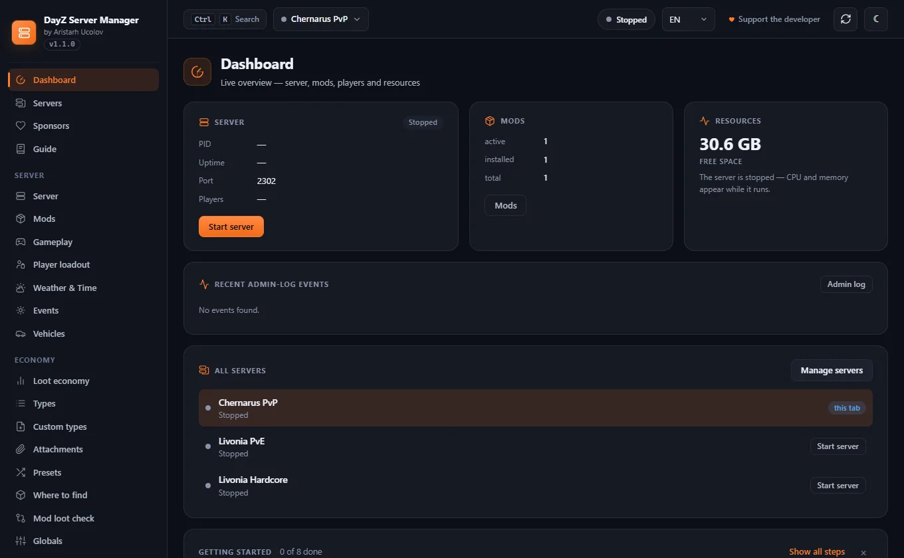
</p>

<table>
  <tr>
    <td width="50%">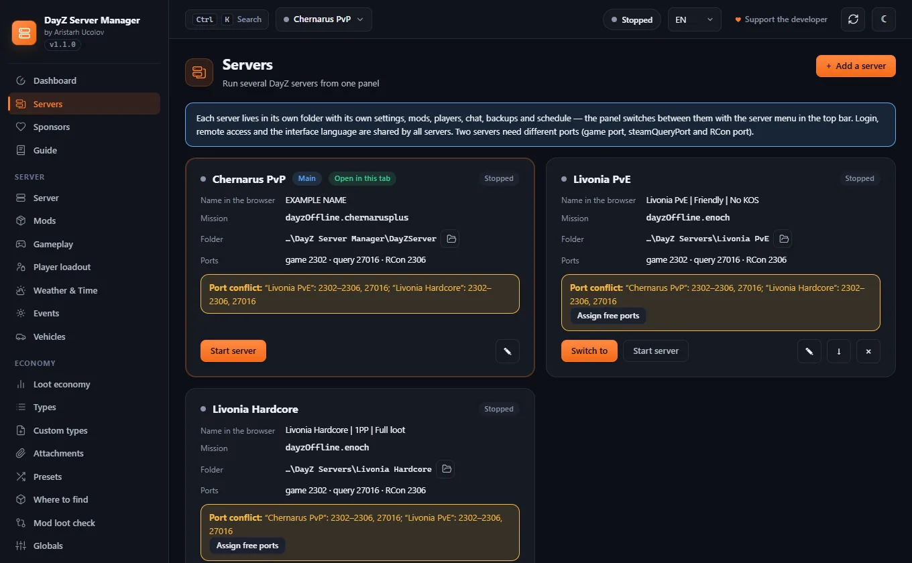<br>
      <b>Servers</b> — several DayZ servers in one panel, each with its own folder, settings and ports</td>
    <td width="50%">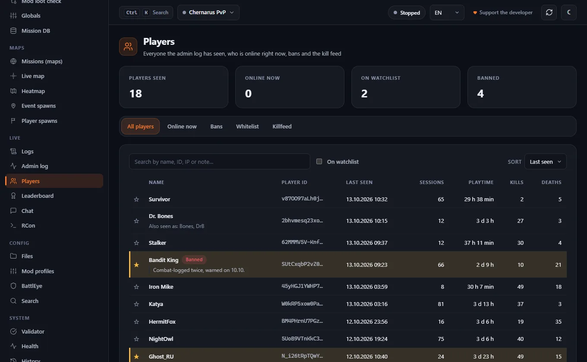<br>
      <b>Players</b> — every player, who is online now, bans with a reason and an end date, the kill feed</td>
  </tr>
  <tr>
    <td width="50%">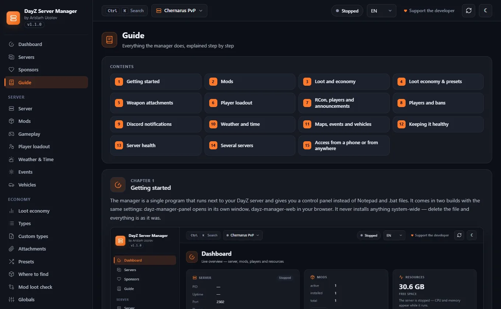<br>
      <b>Guide</b> — fifteen chapters of step-by-step explanations, each with a screenshot and a jump to the section it describes</td>
    <td width="50%">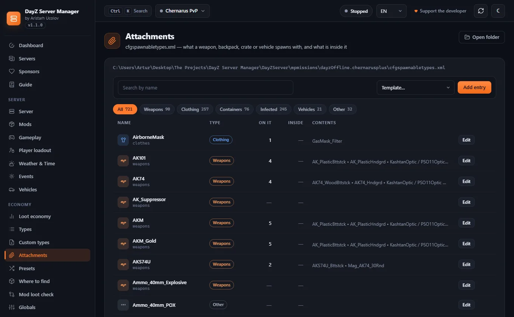<br>
      <b>Attachments</b> — cfgspawnabletypes.xml showing real spawn percentages instead of raw weights</td>
  </tr>
  <tr>
    <td>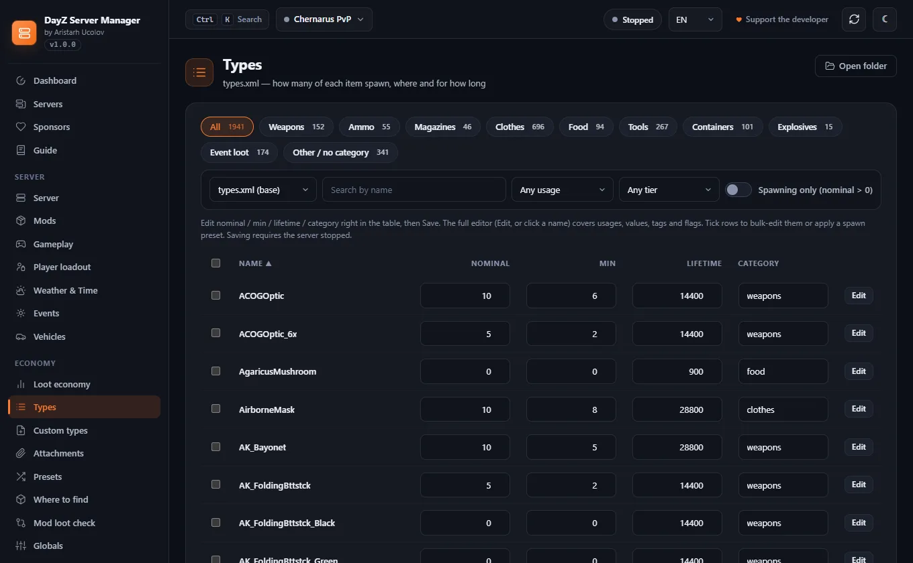<br>
      <b>Loot</b> — types.xml with search, in-table editing and bulk spawn presets</td>
    <td>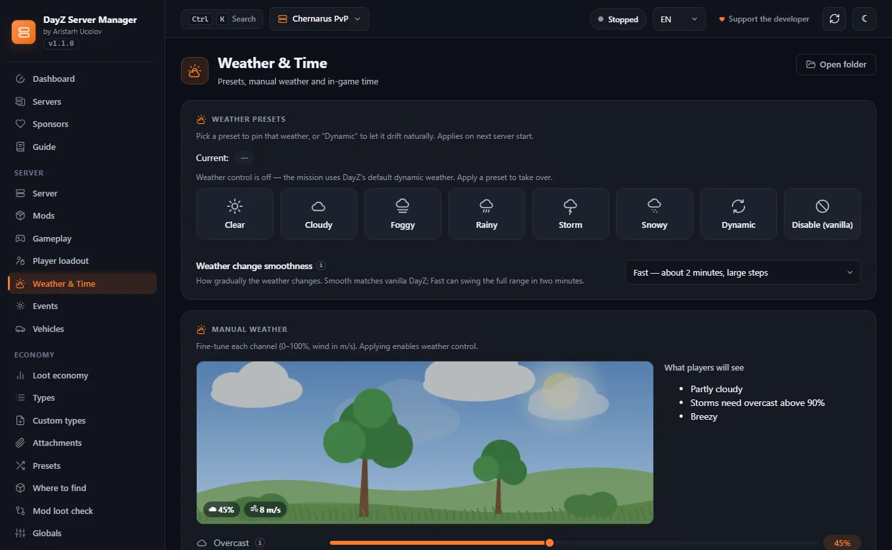<br>
      <b>Weather</b> — presets, manual tuning and transition smoothness</td>
  </tr>
  <tr>
    <td>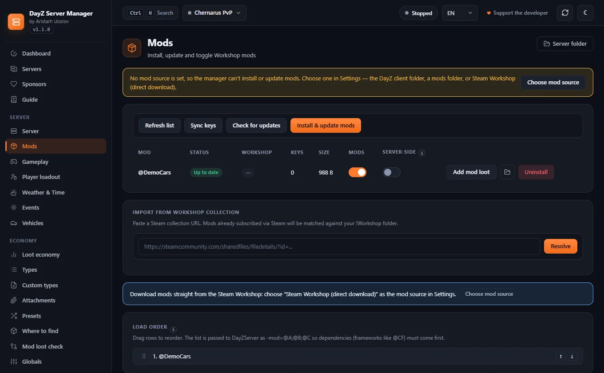<br>
      <b>Mods</b> — install from !Workshop, keys, load order, auto-update</td>
    <td>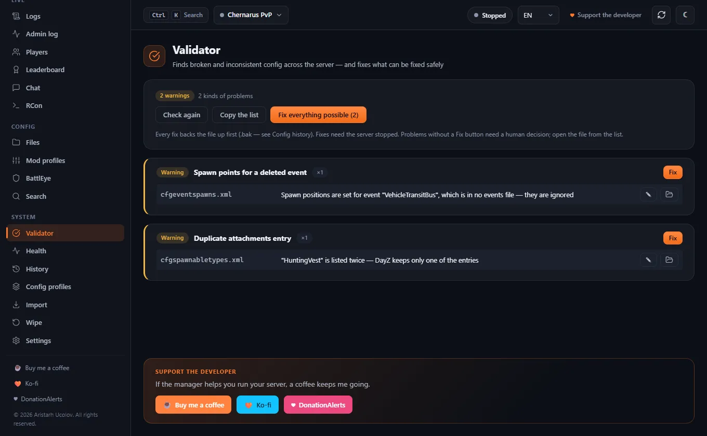<br>
      <b>Validator</b> — XML, cross-file references and value checks with auto-fix</td>
  </tr>
  <tr>
    <td>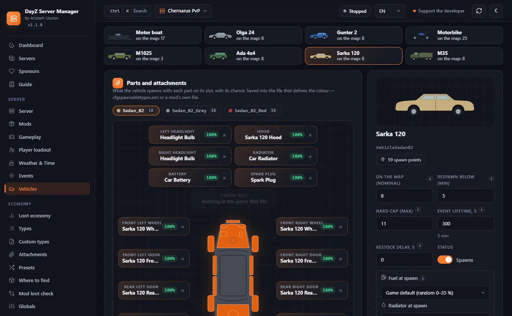<br>
      <b>Vehicles</b> — the car drawn with every part in its place, colours, the trunk, fuel at spawn</td>
    <td>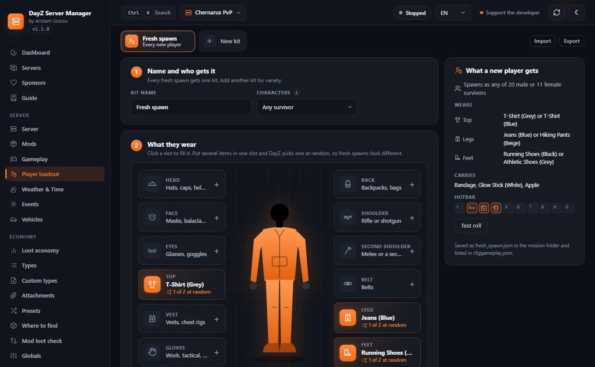<br>
      <b>Player loadout</b> — a survivor with every slot, attachments, hotbar keys, food and warmth at spawn</td>
  </tr>
</table>

## Latest update — 1.1, “The Halloween Update”

**Vehicles** now work like the player loadout: the car drawn from above with a
tile per part, each colour with its own parts and trunk. **Attachments** and
**Presets** share that look — the item drawn, rows with icons instead of bare
class names. The **player loadout** gains hotbar keys for nested items, loaded
weapons (a round already chambered), a fresh character's food, water and
warmth, and DayZ's attachment rules (bayonet vs suppressor, a weapon light and
its rail handguard). The manager comes back by itself after a crash, and Steam
Workshop mods download straight to the server with SteamCMD.

The full list of changes, version by version, is in [CHANGELOG.md](CHANGELOG.md#english).

## What it does

- **Replaces the stock .bat launcher.** Same launch parameters (port,
  cpuCount, BEpath, profiles, -mod, -serverMod, dologs/adminlog/netlog/
  freezecheck, optional filePatching) plus an optional auto-restart loop on
  a configurable interval.
- **Mod install & update from Steam !Workshop.** Point the manager at
  your client DayZ install once — the UI then lists every `@Mod` Steam
  has downloaded. Hit **Install**: the mod is copied into the server dir
  and every `.bikey` is auto-copied into `keys/`. Hit **Update**: it
  re-syncs from Workshop **atomically** (new version is staged in a temp
  dir and only then swapped in, so a broken update can't corrupt the
  server). **Update all outdated** and **Sync all** bring the server dir in
  line with `!Workshop` in one click.
- **Mod auto-update.** Optionally refresh mods before every restart and
  poll `!Workshop` periodically — when a subscribed mod is newer there, the
  server updates and restarts with the usual countdown.
- **Watchdog.** If the server exits on its own, the manager brings it back
  up after 10 seconds. Crash-loop protection (3 exits in 5 minutes) pauses
  auto-restarts and shows a resume banner on the dashboard.
- **Discord notifications.** Server events (start, crash, restarts, mod
  updates, backups) are pushed to a Discord channel via webhook — in the
  panel's language.
- **Load order & server-side mods.** The `-mod=` order is drag-to-reorder
  (dependencies like `@CF` first). A separate toggle marks server-only mods
  (`-serverMod=`).
- **Smart uninstall.** When you remove a mod, keys in `keys/` are only
  deleted if **no other installed mod** provides the same `.bikey`.
  Shared signing keys (e.g. `dayzexpansion.bikey` used across CF /
  Core / AI) stay in place while any component is still installed.
- **server.cfg editor in the browser.** Preserves comments and `class`
  blocks on round-trip. One-field mission template changer — e.g. switch
  from `dayzOffline.chernarusplus` to `dayzOffline.enoch` instantly.
- **types.xml editor.** Searchable table with inline nominal / min /
  lifetime / category editing, plus a per-item editor for restock,
  quantmin/max, cost, flags, usages, values, tags.
- **Spawn presets.** Built-in presets (Military Tier 3/4, Civilian,
  Industrial, Hunting, Rare). Select a set of types → click a preset →
  its usage/value/tag and spawn fields merge into all selected types.
- **Events editor.** Spawn tables for zombies, vehicles and heli crashes:
  nominal/min/max/lifetime/restock plus child spawns.
- **Custom types (moded_types).** Create a new types file; the manager
  **auto-registers** it in `cfgeconomycore.xml`. You can also import
  `*_types.xml` straight out of an installed mod.
- **Attachments editor (cfgspawnabletypes.xml).** Define what a weapon
  spawns with — magazine, optic, buttstock, handguard — as slots with
  probabilities. The panel shows each item's **real spawn chance** (slot
  chance × weight ÷ total weight), which the raw XML makes very easy to
  misread. Ships templates for popular weapons (AKM, AK-74, AKS-74U, M4-A1,
  Mosin, SVD), autocompletes class names from your own `types.xml` (mods
  included) and flags classes missing from it — the usual reason an
  attachment never spawns.
- **Validator with auto-fix.** Scans every `.xml` under `mpmissions/`,
  checks brace balance in `.cfg`, verifies files referenced by
  `cfgeconomycore.xml` exist, flags duplicate types and event spawn positions
  that fall off the map. **Auto-fix** whitelists unknown
  `usage/value/tag/category` into `cfglimitsdefinition.xml`, registers
  unregistered moded_types files in `cfgeconomycore.xml`, removes duplicate
  `<type>` entries — both inside one file and moded copies of a base
  `types.xml` name (keeping the first, comments preserved) — and deletes orphan
  spawn positions for events no longer in `events.xml`. All with a `.bak`.
- **RCon.** Player list, kick/ban, chat broadcast, raw command. Set the
  RCon password right in the panel — the manager writes it into
  `battleye/beserver_x64.cfg` (creating the file if needed).
- **Announcements & restarts.** Scheduled announcements (at a daily time)
  and interval announcements (every N minutes), plus scheduled daily
  restarts at HH:MM with an RCon countdown warning.
- **Weather & time.** Presets, a manual per-channel editor, day/night time
  acceleration and start time (`serverTime`).
- **Server wipe.** Clears saved world state (players, vehicles, bases,
  territories) — persistence folders are first moved to
  `.dayz-manager/wipes/<timestamp>/`, so a mistaken wipe can be restored.
- **Import an existing server.** Point at another server folder — the
  manager previews its mods / mission / serverDZ.cfg and lets you absorb
  what you want.
- **Logs & admin log.** View `.RPT`/`.ADM` with a tailing stream; parse
  admin-log events (connects, kills, chat) with filters.
- **Player database + killfeed.** The manager builds a persistent database
  from the admin log: names (with rename history), GUIDs, first/last seen,
  sessions, playtime, kills/deaths — plus a live killfeed with weapon and
  distance.
- **cfggameplay.json editor.** A form auto-generated from the file's own
  content (stamina, base building, world, UI) plus a raw-JSON mode with
  syntax validation; `enableCfgGameplayFile=1` is set automatically.
- **Performance charts.** Process CPU/memory and players online over time
  (1h/6h/24h) right on the dashboard.
- **Backup / restore.** Download a zip of `manager.json`, `serverDZ.cfg`,
  BE configs and mission files — or restore from one. Every overwrite of a
  DayZ file keeps a `.bak` (5 most recent). **Automatic backups**: the same
  zip on a schedule (every N hours) into `.dayz-manager/backups/` with
  rotation.
- **BattlEye bans editor.** A structured `bans.txt` table (GUID/IP,
  minutes, reason) instead of hand-editing; saving on a running server
  reloads bans via RCon `loadBans` — no restart needed.
- **Write-safety guard.** All file-writing endpoints return `409 Conflict`
  while the server is running (DayZ holds file locks on its working set).
  A warning banner is shown in the UI.
- **Why the server did not start.** While the server is down, the panel reads
  the newest RPT and its own log and shows the reason in plain words: a missing
  mod (named), an unsigned `.pbo`, a port already taken, a malformed
  `serverDZ.cfg`, an economy that failed to load. The raw log line is always
  shown — the matching is heuristic and the judgement stays yours. Nothing
  appears at all on a healthy server.
- **Diff before restore.** The panel has always kept a `.bak` beside every file
  it overwrites, but restoring one was blind. Each backup now has a Compare
  button showing exactly which lines would come back — fast even on a
  30 000-line `types.xml`.
- **Server health.** A page that answers "is anything wrong?" at a glance: is
  the server up (or stuck in a crash loop), is there disk room, does the config
  validate, and — if it won't start — why (the RPT is read for you). Each tile
  links to the page that fixes it. It also offers one-click cleanup: delete
  server logs and crash dumps (the newest RPT/ADM are kept) or old config
  backups to reclaim disk space.
- **Private message to a player.** The RCon page's player list gains a Message
  button next to Kick/Ban — send text to one specific player, not only the
  broadcast-to-everyone Say box.
- **Config history.** The manager already backed a file up before every write;
  now every version of every config is visible in one place, with the date, a
  diff of what a restore would bring back, and one-click restore.
- **Loadout test roll.** The fresh-spawn loadout editor has a "Test roll" button
  that samples one spawn by weight and shows the concrete outcome — which
  character, what is worn and at what condition, what is carried. "Roll again"
  shows the spread.
- **Undo a wipe.** A wipe already *moved* the world folders into
  `.dayz-manager/wipes/<timestamp>/` rather than deleting them, precisely so it
  could be reversed. Now it can be, with one button — and the restore is
  refused, with an explanation, once the server has built new state, so the old
  world can never bury the new one.
- **Player fresh-spawn loadout.** A dedicated section for what a player spawns
  wearing and carrying — clothing by slot and loose inventory items. This is
  NOT Gameplay: the loadout lives in DayZ's spawn-gear presets, which the
  manager creates, registers in cfggameplay.json and switches on for you. If
  the mission still spawns players from init.c, the section says so and offers
  to enable the system with one button. Each item takes a condition — pristine,
  worn, damaged, badly damaged or a custom range; everything defaults to
  pristine. The manager also writes an explicit condition for every item and
  makes loose children (a rag, an apple) inherit it, so a fresh spawn no longer
  arrives with randomly "broken" gear even when an item was left unset.
- **Gameplay made readable.** Every cfggameplay.json field now has a plain-language
  hover tooltip — what stamina, base building, night brightness, the map and so on
  actually do. A "Reset to defaults" button clears every override back to DayZ's
  built-in values while keeping the fresh-spawn loadout registration.
- **Logs out of the mod-config editor.** The mod settings editor no longer lists
  server logs and crash dumps (.RPT, .ADM, script/webapi, crash) — those have
  their own viewers under Logs and Admin-log, leaving only the files admins
  actually edit.
- **Infected split out from weapons.** The 162 zombies in cfgspawnabletypes.xml
  no longer clutter the Weapons filter — they get their own kind, like clothing
  and vehicles do.
- **Leaderboard.** A ranking page: players by playtime, kills, K/D or sessions,
  with medals for the top three. Built from the same player database (playtime,
  kills, sessions).
- **Watchlist and notes.** On the Players page you can flag a player with a star
  and jot down a note (e.g. "suspected duper"). Flagged players get their own
  block at the top; the note and flag survive name changes because they are keyed
  to the player's stable key.
- **Config profiles.** Save the whole configuration (serverDZ.cfg, the mission
  economy files, BattlEye, custom loot) as a named profile and switch between
  them in one click — "Weekend PvP" vs "Weekday PvE". Applying backs up every
  current file first and requires the server stopped.
- **Global config search.** Find any class name, setting or value across every
  config and economy file at once; clicking a result opens the file in the editor
  at that exact line.
- **Loot economy dashboard.** A dashboard page: nominal by category, items by
  usage and by tier, and the top items by nominal — the shape of your economy at
  a glance, with charts.
- **CE tuning presets.** ×2 / ×1.5 / ×0.5 / ×0.25 buttons scale spawn amounts
  (`nominal`, and `min` when checked) across a whole types file in one click,
  keeping the `min ≤ nominal` rule. A **×1** button restores the amounts from
  before your first scaling, so tuning is always reversible. Requires the server
  stopped, keeps a backup.
- **Server map.** A schematic map with a 1 km grid and landmarks — a shared
  component behind the tools below. The manager **recognises the world from the
  mission name** (3 official + ~50 popular modded: Namalsk, Deer Isle, Banov,
  Chiemsee, Rostow, Takistan, Esseker, Sarov, Nyheim, …); any other map is
  auto-registered with its own slot and size. You supply the **real map** yourself: upload an image **or** paste a URL
  (the manager downloads it). We bundle no third-party map imagery — that's
  copyrighted; you point it at a source you have the right to use. **Zoom**
  (wheel/buttons) and **pan** for precise placement — coordinates stay correct at
  any zoom.
- **Heatmap.** Where players die and fights happen, from positions in the admin
  log. Split into PvP, environment and suicides, with filters and a coordinate
  readout under the cursor.
- **Event spawn editor.** `cfgeventspawns.xml` on the map: click to add a point,
  drag to move, right-click to delete. Cross-checked against `events.xml`, so
  events with no spawn points (they never spawn) and orphan points are flagged.
- **Player spawns editor.** `cfgplayerspawnpoints.xml` on the map: switch between
  Fresh / Hop / Travel, each named group shown as a coloured cluster, click to add
  a point, drag to move, right-click to delete. Add/rename/delete groups and tune
  the spawn / generator / group parameters; the distance and grid settings
  round-trip untouched.
- **Live map.** Player positions, auto-refreshing. When RCon is unreachable it
  falls back to the last-known positions (marked as such) so the map never goes
  blank. Vanilla DayZ logs positions only on connect, combat and chat, so a dot
  can lag; positions older than 5 minutes are dimmed.
- **globals.xml form.** A friendly form over the central-economy globals (cleanup
  timers, spawn limits, login/logout, base decay) with a plain-language tooltip
  per known variable. Search, saves only what changed.
- **Where to find.** A reverse loot lookup: type an item's class name → category,
  locations (usage), tier (value), tags, nominal/min. Warns when an item has no
  usage — it won't appear in normal building loot.
- **Presets editor.** `cfgrandompresets.xml`: create your own and edit the
  ready-made cargo/attachment groups, each with an item's real spawn chance
  (group chance × weight ÷ sum of weights); then reference them by name in the
  Attachments editor. Just like Attachments: item class names autocomplete from
  your `types.xml` (mods included) and unknown classes are flagged.
- **Mod loot check.** For each installed mod, shows whether all its loot is in
  the economy: not merged / partly missing / active, with the missing type names
  — the top reason a mod's items don't spawn.
- **Player profile.** Clicking a name anywhere opens a mini admin panel: GUID,
  aliases, first/last seen, stats (sessions, playtime, K/D), recent combat from
  the killfeed, note + watch, and moderation — ban permanently or for a set
  number of days / unban by GUID (in `bans.txt`, applied via RCon `loadBans`
  without a restart), kick and a private message when the player is online.
- **Smart restarts.** Restart only when the server is empty (a scheduled/interval
  restart is deferred while players are online, up to a cap) and restart when the
  DayZ process memory passes a threshold — freeing the creep of long uptimes.
- **Announcement presets.** Saved quick messages on the RCon page: click to
  broadcast to everyone, "Save" to add the current one. Stored in the config.
- **Live chat.** A dedicated page for in-game chat **in real time** — straight
  from the BattlEye RCon stream (vanilla DayZ never writes chat to the admin log).
  Auto-refreshing, with a reply box (broadcast via RCon) and a connection-status
  badge.
- **Watchlist connect pings.** When a watched player joins the server, the panel
  shows a toast.
- **Scheduled config profiles.** Apply a saved profile at a daily time; the swap
  runs during a restart — e.g. a "Weekend" profile on Friday evening.
- **Disk cleanup.** On Server health, separate buttons clear server logs (keeping
  the newest RPT), ADM logs, config backups and old wipe snapshots (the newest is
  kept so a wipe stays undoable).
- **Attachments: random-preset references.** The attachments editor can add
  preset-reference groups from `cfgrandompresets.xml` (the gear ⚙) with name
  autocomplete — for both attachments and cargo — alongside explicit items.
- **Map background.** A schematic Chernarus is drawn by default (grid + coast +
  towns); your own top-down map picture (official or modded) uploads from any map
  page and shows automatically for that world. Ready-made renders are not bundled
  (copyright) — each admin adds their own locally. Modded maps take a world size
  so points and the grid line up.
- **Beginner's guide.** Eleven chapters inside the panel: getting started,
  mods, loot and economy, loot economy & presets, attachments, fresh-spawn
  loadout, RCon, weather, maintenance, server health, remote access. Each has
  numbered steps, a screenshot of the section, a "worth knowing" box, and a
  button that opens the page it describes.
- **Hover help.** Key fields carry an "i" marker: hover it to read what
  `nominal` actually does, how `min` differs from it, why an attachment
  weight is not a percentage, what the time-acceleration and same-build settings
  on the Server page do, and what the numbers on the Loot economy dashboard mean.
  Keyboard-reachable too.
- **Smooth weather transitions.** A transition-speed picker: Smooth
  (~30 minutes in small steps, like vanilla DayZ), Normal (~10 minutes) and
  Fast (~2 minutes). Earlier builds always wrote a two-minute ramp with
  full-range steps, which is what made weather feel like a light switch.
- **23-language UI** with an on-the-fly switcher: English, Русский,
  Deutsch, Français, Español, Italiano, Português, Polski, Čeština, Magyar,
  Nederlands, Svenska, Moldovenească, Türkçe, العربية (right-to-left layout),
  हिन्दी, ไทย, Tiếng Việt, Bahasa Indonesia, 中文, 繁體中文, 日本語, 한국어.
  A new install opens in the browser's language.
- **Local, LAN or Internet exposure.** Default bind is `127.0.0.1`. Local
  network only lets devices from your network in; Internet lets anyone reach
  the panel, so it requires the panel login. Requests from other websites and
  foreign host names (DNS rebinding) are refused.
- **Panel login** (optional — chosen in the first-run setup or Settings →
  Access & security): salted PBKDF2 password hashes, remember-me per device,
  lockout after repeated wrong attempts, a list of signed-in devices with
  sign-out. Forgot the password? Start the manager with `-reset-login`.
- **Remote access** (Settings → Access & security): explains why a phone "goes
  offline" outside the home network and checks every step — Internet
  exposure, automatic router port forwarding (UPnP), a Windows Firewall rule,
  HTTPS on the same port, and a public-IP / CGNAT check that shows the exact
  address to open from outside. It can forward the game ports too.
- **Chat archive**: messages sent from the manager show up in the chat feed,
  and every day is archived with search and a .txt download.
- **Server page**: missions from `mpmissions` as map cards (make one active in
  a click), `serverDZ.cfg` grouped into sections with switches, and launch
  parameters with a server FPS limit (`-limitFPS`) and free-form extra
  DayZServer parameters.
- **Settings in tabs**: General, Access & security, Restarts & schedule,
  Backups, Discord.
- **Modded vehicles on the Vehicles page**: events from every file registered
  in `cfgeconomycore.xml`, cars recognised by their parts, edits saved into the
  file the car lives in; vehicles a mod ships server files for are added in one
  click (copied into the mission's `dzm_vehicles` folder).
- **Linux**: the app window or browser opens also when started as root/sudo and
  with snap/flatpak browsers; the terminal shows the panel address, and a server
  without a desktop gets instructions (SSH tunnel) and `-set-login`/`-exposure`.
- **Server FPS on the dashboard**, read from the "Average server FPS" line of
  the `.RPT` log (set `logAverageFps` in the Server log group on the Server
  page; needs `-dologs`).

## Build

Pre-built binaries are on the GitHub Releases page. Building from source needs
Go 1.23+.

```bash
# from the project root — development builds
go build -o dayz-manager-web.exe ./cmd/manager
go build -o dayz-manager-panel.exe ./cmd/panel
```

Release builds. `-s -w` drop the symbol table and DWARF debug info — about
3.4 MB that is never read at runtime. They do not affect behaviour or panic
tracebacks (Go takes function names and line numbers from `pclntab`, which
these flags leave alone), so a crash report from a user is just as detailed.
**The binaries on GitHub Releases are built this way.** `-H windowsgui` keeps
the desktop app from opening a console window:

```bash
python tools/build_release.py           # all four + dayz-manager-linux.tar.gz + dayz-manager-windows.zip
python tools/build_release.py linux     # Linux only
python tools/build_release.py windows   # Windows only
```

The script hands each build its target system directly (no shell syntax) and
checks that every file really is a program for that system: a `-linux` file
must start with `ELF`, an `.exe` with `MZ`. `GOOS=linux go build …` only works
in bash — in cmd and PowerShell it silently builds a **Windows** file under the
`-linux` name, which Linux refuses ("Exec format error"); `make_linux_tarball.py`
no longer packs such a file. By hand:

```bash
go build -ldflags="-s -w" -o dayz-manager-web.exe ./cmd/manager
go build -ldflags="-s -w -H windowsgui" -o dayz-manager-panel.exe ./cmd/panel
GOOS=linux GOARCH=amd64 go build -ldflags="-s -w" -o dayz-manager-web-linux ./cmd/manager   # bash only
GOOS=linux GOARCH=amd64 go build -ldflags="-s -w" -o dayz-manager-panel-linux ./cmd/panel   # bash only
```

Nothing needs cgo, so cross-compiling from any OS works with the same commands
(`GOOS=windows GOARCH=amd64` for Windows).

**The app window.** On Windows `dayz-manager-panel` shows the panel in an
embedded Microsoft Edge WebView2 window (already present on Windows 10/11) with
a tray icon, remembers the window's size and place, and on the first start
offers to add itself to the Start menu and the desktop (`-install` /
`-uninstall` do the same from the command line). Without WebView2 it offers
Microsoft's download and meanwhile opens in Edge/Chrome in app mode or in the
regular browser. On Linux the panel opens in its own app window built on
WebKitGTK — present on nearly every desktop (`libwebkit2gtk-4.1-0` on Debian /
Ubuntu / Mint); without it, in Chrome / Chromium / Edge / Brave in `--app` mode
or the browser. With no desktop (a VPS over SSH) the app just prints the panel
address.

**Windows.** The easiest download is `dayz-manager-windows.zip` — both
programs and a short readme. Unpack it into the server folder next to
`DayZServer_x64.exe`.

**Linux.** The easiest download is `dayz-manager-linux.tar.gz` — both files
in it are already executable. Unpack it into the server folder next to the
`DayZServer` binary (the Linux server, no `.exe`).

*With a desktop.* Browsers save a download without the permission to run it,
and GNOME Files and many other file managers do not start programs on a double
click at all — that is why "the file does not open". Run this once in a
terminal in the server folder:

```bash
chmod +x dayz-manager-panel-linux
./dayz-manager-panel-linux -install
```

The manager appears in the applications menu (and as a desktop shortcut) —
start it from there like any app. `-uninstall` removes the shortcuts. Started
without a terminal, errors and the panel address are shown in a window (zenity
/ kdialog) instead of being lost.

*Without a desktop (a VPS over SSH):*

```bash
chmod +x dayz-manager-web-linux
./dayz-manager-web-linux -no-browser -bind 0.0.0.0
```

The Linux DayZ server needs mod folder and file names in lowercase — the manager
does that itself on install and update, and flags problems on the **Mods** page.
To start the manager with the system, a sample systemd unit
(`/etc/systemd/system/dayz-manager.service`):

```ini
[Unit]
Description=DayZ Server Manager
After=network-online.target

[Service]
User=dayz
WorkingDirectory=/home/dayz/server
ExecStart=/home/dayz/server/dayz-manager-web-linux -no-browser -bind 0.0.0.0
# Only the manager gets SIGTERM: it shuts DayZ down cleanly itself (#shutdown)
KillMode=mixed
TimeoutStopSec=90
Restart=on-failure

[Install]
WantedBy=multi-user.target
```

```bash
sudo systemctl daemon-reload && sudo systemctl enable --now dayz-manager
```

**Icon and file properties.** `cmd/manager/resource_windows_amd64.syso` and
`cmd/panel/resource_windows_amd64.syso` are committed and `go build` links them
automatically. Regenerate them only when the icon or the version changes:

```bash
go install github.com/josephspurrier/goversioninfo/cmd/goversioninfo@latest
# after editing the version in cmd/<manager|panel>/versioninfo.json:
cd cmd/manager && goversioninfo -64 -icon=icon.ico -o resource_windows_amd64.syso versioninfo.json
cd ../panel   && goversioninfo -64 -icon=icon.ico -o resource_windows_amd64.syso versioninfo.json
```

The program version lives in `internal/launcher/version.go`; bump it and both
`versioninfo.json` files on release, or Properties → Details will show the old
number.

The resulting binary is fully self-contained — the web UI is embedded via
`//go:embed`. No Node.js, no runtime deps.

### Usage

1. Copy `dayz-manager-panel.exe` (or `dayz-manager-web.exe`) into your DayZ
   Server folder, next to `DayZServer_x64.exe` and `serverDZ.cfg`.
2. Double-click it. The panel window opens (the browser build opens
   `http://127.0.0.1:8787/`).
3. On first run pick a language, where mods come from (the game client, a mods
   folder, or server-only) and `Local` or `LAN/Internet` exposure.
4. Work through the "Getting started" checklist on the dashboard. **Stop the
   server** before editing files.

### Command-line flags

| flag           | default          | meaning                                             |
|----------------|------------------|-----------------------------------------------------|
| `-port`        | `8787`           | Panel port. If another program holds it, the next free port is used. |
| `-bind`        | *(from settings)* | Bind address. Blank = follows exposure: `127.0.0.1` for Local, `0.0.0.0` for LAN. |
| `-no-browser`  | `false`          | `dayz-manager-web` only: don't auto-open the browser on start. |
| `-reset-login` | `false`          | Turn the panel login off (forgotten password), then start as usual. |
| `-set-login NAME` | —             | Turn the panel login on for this user (asks for the password in the terminal), then start — for a server without a desktop. |
| `-exposure MODE` | —              | Save the panel exposure before starting: `local`, `lan` or `internet` (`internet` needs a login). |
| `-install`     | —                | Linux: add the manager to the applications menu and the desktop, then exit (`-uninstall` removes it). |
| `-autostart`   | `false`          | Started together with the computer: no browser, the app stays in the tray. Set by Settings → General → Startup. |
| `-dir FOLDER`  | *(working or program folder)* | The DayZ server folder when the manager lives elsewhere. |
| `-version`     | —                | Print version and exit.                             |

Launching it a second time doesn't start a second manager — it just brings up
the panel that is already running.

### Running as a Windows Service (NSSM)

For unattended hosting, run the browser build as a service with
[NSSM](https://nssm.cc/):

```bat
nssm install DayZManager "C:\DayZServer\dayz-manager-web.exe"
nssm set DayZManager AppDirectory "C:\DayZServer"
nssm set DayZManager AppParameters "-bind 0.0.0.0 -no-browser"
nssm set DayZManager Start SERVICE_AUTO_START
nssm start DayZManager
```

The panel will be reachable at `http://<server>:8787/` right after Windows
boots. Before exposing it beyond this machine, turn on the panel login
and run the remote-access checks — both on Settings → Access & security.

## REST API (summary)

- `GET  /api/info` — app info
- `GET  /api/i18n` — string bundle + language list
- `GET  /api/config` · `POST /api/config` — manager config
- `POST /api/config/finish-first-run` — first-run wizard submission
- `GET  /api/server/status` — PID / uptime / port / running
- `POST /api/server/{start|stop|restart}`
- `GET  /api/servercfg` · `POST /api/servercfg` — read & write kv block
- `POST /api/servercfg/mission` — change mission template
- `GET  /api/mods` — Workshop + installed
- `POST /api/mods/{install|uninstall|update|update-all|sync-all|sync-keys|enable|order}`
- `GET  /api/types?file=...` · `GET /api/types/item` · `POST /api/types/bulk-patch`
- `GET  /api/types/presets` · `POST /api/types/apply-preset`
- `GET  /api/events` · `GET /api/moded` · `POST /api/moded/{create|delete}`
- `GET  /api/validate` · `POST /api/validate/fix`
- `GET  /api/rcon/players` · `POST /api/rcon/{say|kick|ban|command}`
- `GET  /api/weather` · `POST /api/weather/{preset|custom|time}`
- `GET  /api/wipe/preview` · `POST /api/wipe`
- `GET  /api/logs/{list|read|stream}` · `GET /api/admlog/recent`
- `GET  /api/backup/export` · `POST /api/backup/import`
- `GET  /api/files/tree?path=...` · `GET /api/files/read?path=...` · `POST /api/files/write`
- `GET  /api/setup/checklist` — the dashboard's getting-started list
- `GET  /api/vehicles` · `POST /api/vehicles/parts`
- `GET  /api/missions/{full|available|linked}` · `POST /api/missions/{install|import|activate|delete}`
- `GET  /api/map/{layers|layer.png|buildings|zones}` — map layers drawn from the mission files
- `GET  /api/server/tuning` · `POST /api/fs/reveal` · `GET /api/mods/source/inspect`
- `GET  /api/auth/status` · `POST /api/auth/{login|logout|setup|change|disable|trust|revoke}` · `GET /api/auth/settings`
- `GET  /api/remote/status` · `POST /api/remote/{upnp|check|firewall}`
- `GET  /api/rcon/chat/recent` · `GET /api/chat/{days|archive|export}`

With the panel login on, every `/api/` endpoint except `info`, `i18n` and
`auth/{status,login,logout}` needs a session cookie.

All write endpoints return `409 Conflict` if the DayZ server is currently
running.

## Sponsors

The project grows thanks to its supporters. The people who chipped in — and the
ways to help — are in [SPONSORS.md](SPONSORS.md) and on the **Sponsors** page
inside the manager. Thank you! 💙

## License

Copyright © 2026 Aristarh Ucolov. All rights reserved. See
[LICENSE.md](LICENSE.md).
